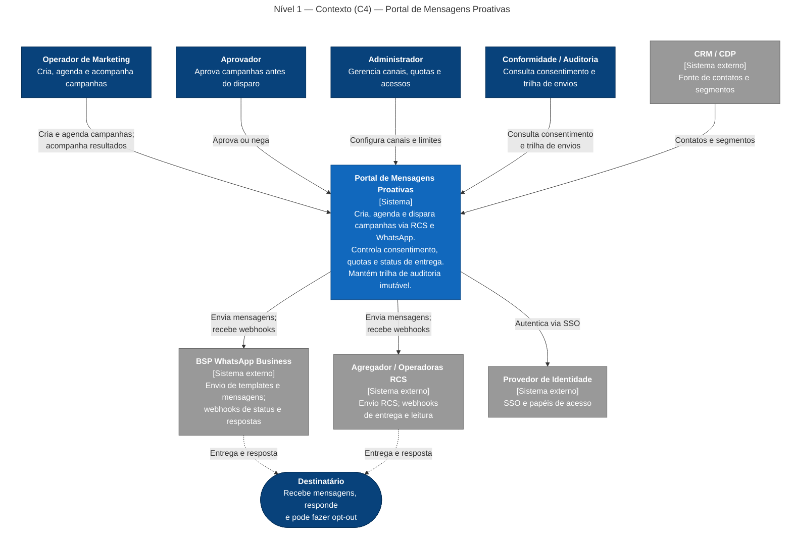
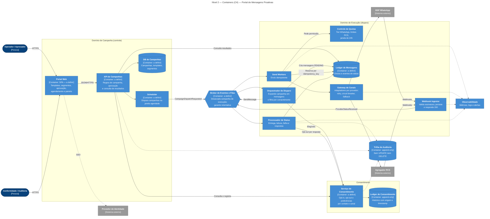
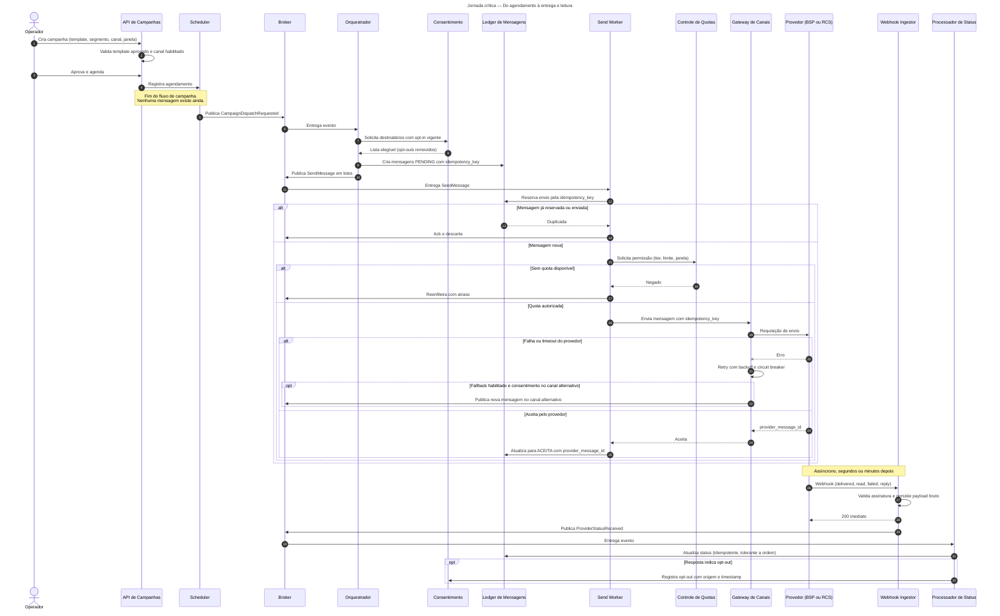
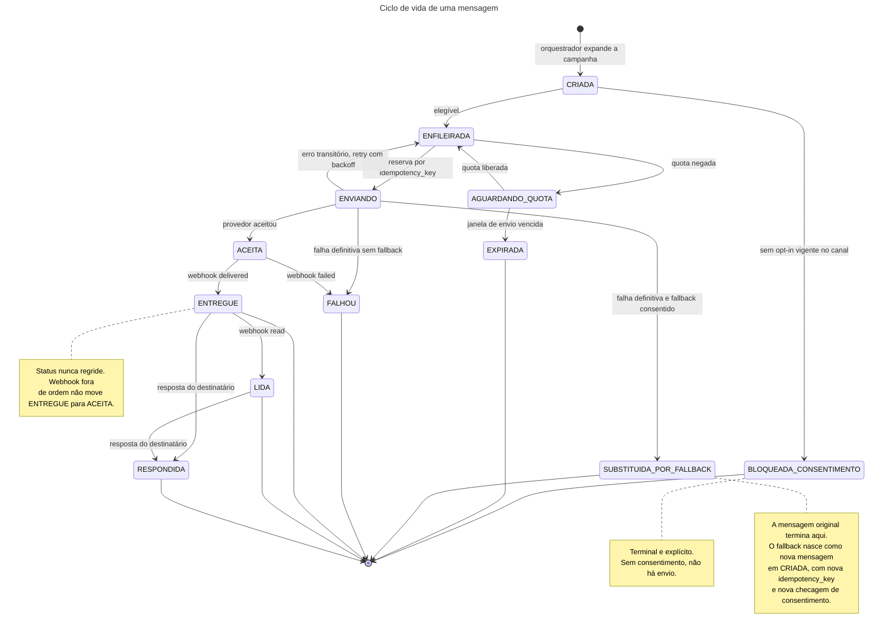

# Portal de Mensagens Proativas (RCS e WhatsApp) — documentação como código

Base de documentação arquitetural de um portal web para **criar, aprovar, agendar, disparar e acompanhar campanhas de mensagens proativas** via RCS e WhatsApp Business API — construída como exercício de *discovery* de documentação com apoio de GenAI.

> **[COMPLETAR]** Contexto do projeto: de onde vem o sistema, quem são os usuários reais e qual problema ele resolve hoje. Esta seção deve ser escrita por quem conhece o cenário; o restante do repositório parte das premissas listadas em [`docs/01-descricao-sistema.md`](docs/01-descricao-sistema.md).

**Os diagramas são código.** Ficam em `docs/diagramas/*.mmd`, são versionados, revisáveis em *pull request* e reproduzíveis — e, por estarem em texto, servem de contexto para agentes de desenvolvimento implementarem o sistema com aderência à arquitetura documentada.

---

## Índice

| Documento | O que contém |
| --- | --- |
| [`docs/01-descricao-sistema.md`](docs/01-descricao-sistema.md) | Escopo, nível da visão, limites e responsabilidades, integrações, restrições, invariantes e lacunas |
| [`docs/02-decisoes-e-ajustes.md`](docs/02-decisoes-e-ajustes.md) | O que a GenAI gerou, o que foi ajustado e por quê |
| [`prompts/arquiteto-de-software.md`](prompts/arquiteto-de-software.md) | O prompt usado no *discovery*, versionado como artefato do projeto |
| [`adr/`](adr) | Decisões arquiteturais registradas |
| [`docs/diagramas/`](docs/diagramas) | Fonte dos diagramas em Mermaid (`.mmd`) |

---

## O sistema em um parágrafo

O portal centraliza o ciclo de vida de campanhas de mensagens proativas para times de negócio e marketing: criação, aprovação, agendamento, disparo, rastreamento de entrega, leitura, resposta e erro. Ele **não** aprova templates junto à Meta ou às operadoras, **não** define regras de negócio de marketing, **não** decide qual BSP contratar e **não** substitui análise jurídica de LGPD: consome provedores externos por uma camada de abstração e executa a política de consentimento e de quotas definida pelo negócio e pela conformidade. A pergunta que precisa responder a qualquer momento é: *quem recebeu o quê, por qual canal, com qual consentimento, e em que estado está.*

Descrição completa em [`docs/01-descricao-sistema.md`](docs/01-descricao-sistema.md).

**Ordem de prioridade em caso de conflito:** conformidade/consentimento > confiabilidade de entrega > rastreabilidade/auditoria > performance > custo por mensagem.

### Invariantes

Regras que nenhuma implementação pode violar. Estão aqui no README, e não só na descrição, porque são o critério de aceitação de qualquer mudança — humana ou gerada por agente.

1. Nenhuma mensagem é enviada sem consentimento vigente no canal de destino, verificado no ledger no momento do envio.
2. Todo envio tem `idempotency_key` única. Retry nunca gera segundo disparo.
3. Nenhuma chamada a provedor acontece fora do Gateway de Canais.
4. Toda decisão de quota é explícita. Sem quota, a mensagem é reenfileirada com atraso; o limite nunca é ignorado nem a mensagem descartada em silêncio.
5. Todo webhook é persistido antes de ser confirmado (200) ao provedor.
6. Fallback de canal só ocorre com consentimento no canal alternativo.
7. Status de mensagem nunca regride. Webhook fora de ordem não desfaz `ENTREGUE` ou `LIDA`.
8. Os ledgers de consentimento e de auditoria não aceitam `UPDATE` nem `DELETE`.

---

## Diagramas

### 1. Contexto — nível 1 do C4

A plataforma como caixa preta. Quem interage com ela e de quais sistemas ela depende. Público: negócio, conformidade e gerência.

<!-- diagrama:c4-contexto:inicio -->

<!-- diagrama:c4-contexto:fim -->

### 2. Containers — nível 2 do C4 *(estrutural)*

Unidades executáveis e como se comunicam. Público: quem vai implementar.

Dois pontos que valem leitura atenta: o **Domínio de Campanha** só publica um evento no broker, porque criar e aprovar campanha é de baixo volume e consistência forte, enquanto disparar é de alto volume e assíncrono; e o **Ledger de Consentimento** é um container próprio, separado do banco de campanhas, porque é *append-only* e consultado antes de todo envio. As tecnologias estão como `a definir` porque a stack do time não foi informada (ver lacunas).

<!-- diagrama:c4-containers:inicio -->

<!-- diagrama:c4-containers:fim -->

### 3. Sequência — jornada crítica *(comportamental)*

Da campanha agendada até a leitura pelo destinatário. O diagrama inclui de propósito os caminhos que não são felizes: mensagem duplicada, quota negada, falha do provedor com retry e fallback condicionado a consentimento, e opt-out recebido por resposta.

<!-- diagrama:sequencia-disparo-campanha:inicio -->

<!-- diagrama:sequencia-disparo-campanha:fim -->

### 4. Estados — ciclo de vida da mensagem *(comportamental)*

Diagrama adicionado na revisão, não na primeira geração: é ele que torna as invariantes visíveis. `BLOQUEADA_CONSENTIMENTO` e `SUBSTITUIDA_POR_FALLBACK` são estados terminais e explícitos justamente para que nenhuma implementação futura os trate como caminho para o envio.

<!-- diagrama:estado-mensagem:inicio -->

<!-- diagrama:estado-mensagem:fim -->

---

## Decisões e ajustes sobre o que a GenAI gerou

Resumo. Íntegra, com o raciocínio de cada uma, em [`docs/02-decisoes-e-ajustes.md`](docs/02-decisoes-e-ajustes.md).

> **[COMPLETAR]** A tabela abaixo registra a revisão do rascunho contra as regras do prompt. Substitua ou acrescente linhas com as divergências reais que você observar ao comparar a saída do modelo com o seu conhecimento do sistema.

| # | O que o rascunho tendia a trazer | O que foi ajustado | Por quê |
| --- | --- | --- | --- |
| 1 | Portal chamando o provedor diretamente | Gateway de Canais com adaptadores por provedor | Evita acoplamento a um BSP; provedores mudam, caem ou têm custos distintos por canal |
| 2 | Consentimento como filtro dentro do serviço de audiência | Serviço e ledger de consentimento próprios, atualizados por respostas | Opt-in é modelo de dados, não validação secundária; exige histórico e origem |
| 3 | Envio síncrono da API ao provedor | Fluxo orientado a eventos: Scheduler, Orquestrador, Workers | Campanha e disparo têm escalas e falhas diferentes |
| 4 | Sem controle de duplicidade | `idempotency_key` gerada na criação e reserva no ledger antes do envio | Retry e reentrega de fila não podem gerar duplo disparo |
| 5 | Rate limit como detalhe do worker | Controle de Quotas como componente de primeira classe | Tier do WhatsApp e status do agente RCS são restrição de desenho |
| 6 | Webhook processado no mesmo request | Ingestor persiste e responde 200; Processador de Status é assíncrono | Evita timeout e perda de eventos; status chega fora de ordem |
| 7 | Fallback automático de canal | Fallback só com consentimento no canal alternativo | Conformidade tem prioridade sobre entrega |
| 8 | `C4Container` nativo do Mermaid | `flowchart` com `classDef` na paleta C4 | Sintaxe C4 é experimental e renderiza de forma instável |

**O que foi mantido do rascunho:** a decomposição em domínios de campanha e execução com broker entre eles, o Scheduler como container próprio e a ideia de ledger append-only para consentimento e auditoria — esta ainda marcada como `[A VALIDAR]`, pendente do [ADR-001](adr/ADR-001-ledger-consentimento-append-only.md).

---

## Método

O *discovery* foi conduzido com um agente Arquiteto de Software cujo prompt está versionado em [`prompts/arquiteto-de-software.md`](prompts/arquiteto-de-software.md).

Antes de qualquer proposta, o agente, rodando em modo de esclarecimento, devolveu **7 perguntas** (volume e criticidade, provedores, fallback, multi-tenant, stack, auditoria). Nenhuma foi respondida antes da geração dos diagramas. Por isso elas viraram a seção de *Lacunas* e as premissas marcadas como `[PREMISSA]`: sem essa marcação, seriam caixinhas de nome plausível e o desenho pareceria completo sem ser verdadeiro.

Sequência executada:

1. **Esclarecer** — perguntas antes de qualquer decisão difícil de reverter.
2. **Descrever** — texto em linguagem natural, com lacunas declaradas.
3. **Diagramar** — Mermaid gerado a partir da descrição.
4. **Revisar** — o desenho conferido contra as regras e prioridades do prompt.
5. **Registrar** — ajustes documentados com o motivo, não só o resultado.

---

## Reprodutibilidade

Os arquivos `.mmd` em `docs/diagramas/` são a fonte de verdade; o README apenas os exibe, dentro de marcadores `<!-- diagrama:NOME:inicio -->` e `<!-- diagrama:NOME:fim -->`. Para reinjetar o conteúdo dos `.mmd` nos blocos do README:

```
node scripts/sync-diagramas.mjs          # atualiza o README
node scripts/sync-diagramas.mjs --check  # falha se estiver dessincronizado
```

Para renderizar em SVG ou PNG localmente:

```
npm install -g @mermaid-js/mermaid-cli
mmdc -i docs/diagramas/c4-containers.mmd -o c4-containers.svg
```

> **[A VALIDAR]** Os quatro diagramas foram escritos com cuidado de sintaxe, mas ainda não foram renderizados. Rode o `mmdc` (ou abra o README no GitHub) e registre aqui qualquer correção feita.

---

## Este repositório como contexto para agentes

Um agente que for implementar este sistema lendo este repositório precisa de três coisas que um leitor humano dispensaria:

- **Invariantes escritas como regra**, não como prosa — a lista acima existe para ser citada literalmente num prompt de implementação e virar critério de aceitação de *pull request*.
- **Lacunas marcadas.** Um agente preenche silenciosamente o que não encontra. Um `[LACUNA]` explícito é instrução para perguntar, não para inventar.
- **Diagramas em código.** Um `.mmd` versionado é texto que o agente lê, compara com o código e usa para detectar divergência. Um PNG é opaco.

---

## Estrutura

```
.
├── README.md
├── adr/
│   ├── ADR-000-template.md
│   └── ADR-001-ledger-consentimento-append-only.md
├── docs/
│   ├── 01-descricao-sistema.md
│   ├── 02-decisoes-e-ajustes.md
│   └── diagramas/
│       ├── c4-contexto.mmd
│       ├── c4-containers.mmd
│       ├── sequencia-disparo-campanha.mmd
│       └── estado-mensagem.mmd
├── prompts/
│   └── arquiteto-de-software.md
└── scripts/
    └── sync-diagramas.mjs
```

---

## Status

Fase de *discovery* de documentação. **Nenhuma decisão aqui está fechada** — os ADRs estão em status `Proposto`, as lacunas seguem abertas e a implementação ainda não começou. Este repositório é insumo para decisão, não a decisão.

## Licença

[MIT](LICENSE).
